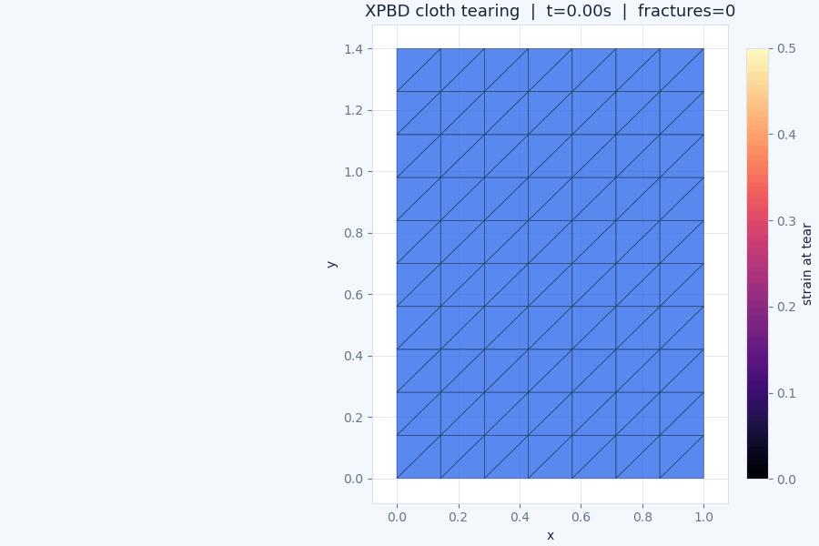
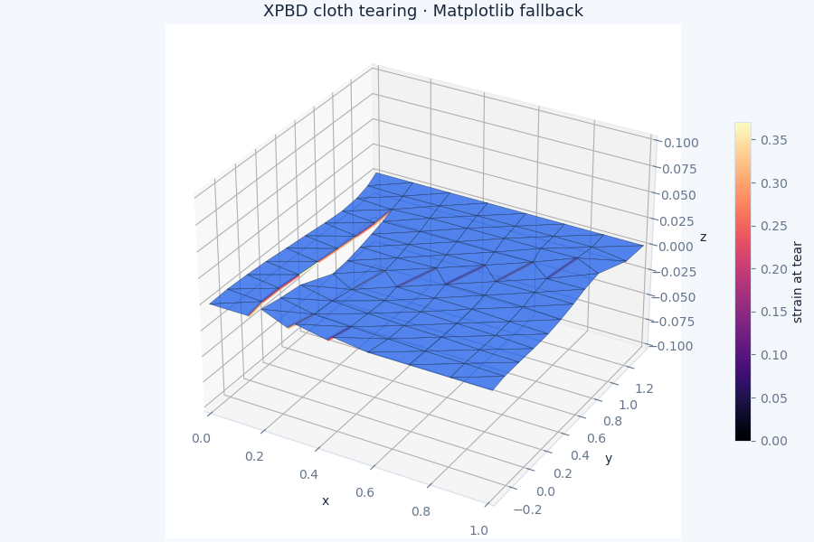

# XPBD + MPM：布料撕裂与规定运动耦合

## 贡献

作者主导，负责目标、范围、工作流制订与验收。Codex（GPT-6 Astra）承担 XPBD 布料侧开发、接口核验及联合候选集成；Claude Opus5.5 承担 MPM 侧开发、两进程适配器与运行工具；DeepSeekV4.1 Flash 协助技术审查。工具协助不替代使用者对模型、结果和发布范围的判断。

## 内容与范围

- `project/`：Python / Taichi XPBD 布料、断边与顶点复制、拓扑重建、表面查询、合成受载、支撑诊断及离线回放。
- `mpm/`：MPM 干砂求解器、规定几何布面接口、两进程传输、运行与数值判读工具、必要测试和输入数据。
- `assets/`：既有 XPBD 展示，不是真实 MPM 耦合视频。
- `RUN_COUPLED.txt`：联合运行参数及输出注意事项。

### XPBD 算例与诊断展示



*布料动画：网格变形与断裂演化。画面标有模拟时间、断裂计数和断裂应变色标。*



*静态诊断图：Matplotlib 渲染的布料网格、裂口及断裂应变色标。*

联合场景限固定或恒速平移的规定布面影响真实 MPM。布面载荷仅记账而不驱动几何。

## 环境

联合运行使用命名 Conda 环境 `MPM_couple`。以下命令均从仓库根目录执行；环境已存在时跳过创建。

```powershell
conda env create -f mpm/environment.yml
```

本次实际使用 Python 3.10.22、NumPy 1.26.4、Taichi 1.7.4、pytest 9.2.0，CPU 后端。Windows 请使用 `conda run` 或正确激活环境，避免科学计算 DLL 搜索路径不完整。

仅做 XPBD 工作时，可用根目录 `environment.yml` 创建 `XPBD_tear`；`requirements.txt` 为 pip 补充，不能单独重建环境。GPU 理论可用，暂未开展验证。

## 快速检查

```powershell
conda run --no-capture-output -n MPM_couple python -B mpm/src/tests/test_public_candidate.py
New-Item -ItemType Directory -Force -Path ../xpbd-results
conda run --no-capture-output -n MPM_couple python -B -m project.tests.test_registered_kinematic --output ../xpbd-results/registered.json
```

第一条为 7 项标准库定向回归，覆盖变换契约、配置路径/异常拒绝、禁止提前启动进程、结果门连接，以及临时目录内的本地发布元数据与禁止覆盖；无物理模拟或网络上传。（我服了Astra的雷霆大防御，加上也挺好的）第二条是 24 项合成登记与几何桥 host-only 测试，无 Taichi/MPM启动或真实对端认证。输出 JSON 必须是新文件。

`mpm/data/contract-vectors.json` 与网格是随包锁定输入，不能用重新导出的文件直接覆盖。运行环境与源码摘要可能使重导出文件的字节摘要不同。

## 六例联合运行

```powershell
conda run --no-capture-output -n MPM_couple python -B mpm/src/tools/u4_joint.py --results ../mpm-results
```

也可运行 `./mpm/run.ps1 --results ../mpm-results`，或在 Bash 中运行 `bash mpm/run.sh --results ../mpm-results`。默认定位包内 XPBD 源码及 `mpm/data/`；可显式传入 `--xpbd-root`、`--mesh-dir`，固定输入摘要仍须匹配。

顺序为源码锁定、输入与变换前置核验、内存监测预检、冒烟、安全测试，再逐例模拟与判读。配置限定锁定包内场景；R/c/C、`fixed-transform-v1` 标记或字段不符合要求时，在任何进程/物理步骤前停止；结果门继续使用同一检查。

六例共 960 窗，H=h=1 ms、MPM dt=0.2 ms，CPU f64。默认上限为每子进程 15 分钟、整包 60 分钟、进程树内存 4 GiB；不可测量或超预算会停止。`--rehearse-windows` 短窗运行只算诊断。

耦合demo绝赞制作中……

## 参考文献

[1] Müller M, Heidelberger B, Hennix M, et al. Position based dynamics[J]. Journal of Visual Communication and Image Representation, 2007, 18(2): 109-118. [DOI: 10.1016/j.jvcir.2007.01.005](https://doi.org/10.1016/j.jvcir.2007.01.005).

[2] Macklin M, Müller M, Chentanez N. XPBD: Position-based simulation of compliant constrained dynamics[C]//Proceedings of the 9th International Conference on Motion in Games. New York: ACM, 2016: 49-54. [DOI: 10.1145/2994258.2994272](https://doi.org/10.1145/2994258.2994272).

[3] Macklin M, Storey K, Lu M, et al. Small steps in physics simulation[C]//Proceedings of the ACM SIGGRAPH/Eurographics Symposium on Computer Animation. New York: ACM, 2019: 1-7. [DOI: 10.1145/3309486.3340247](https://doi.org/10.1145/3309486.3340247).

项目仍持续研究中，特别感谢Taichi社区中曾经活跃的重要贡献者们，为作者提供灵感与参考。
